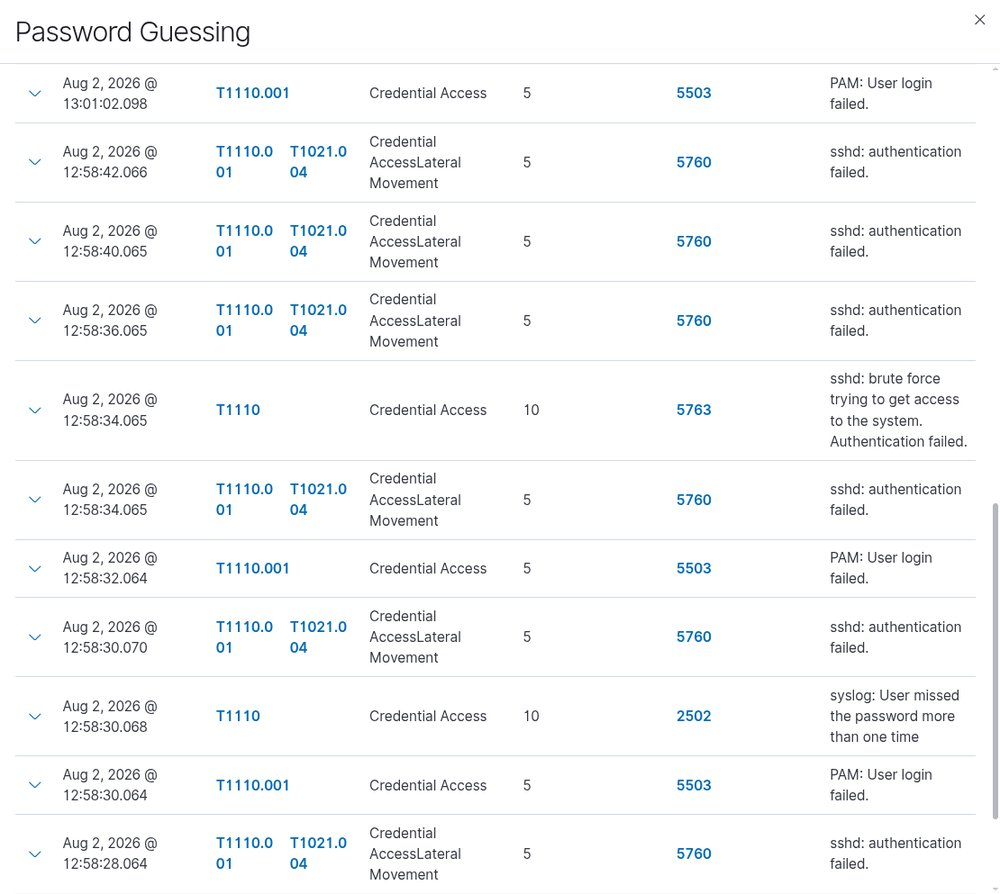
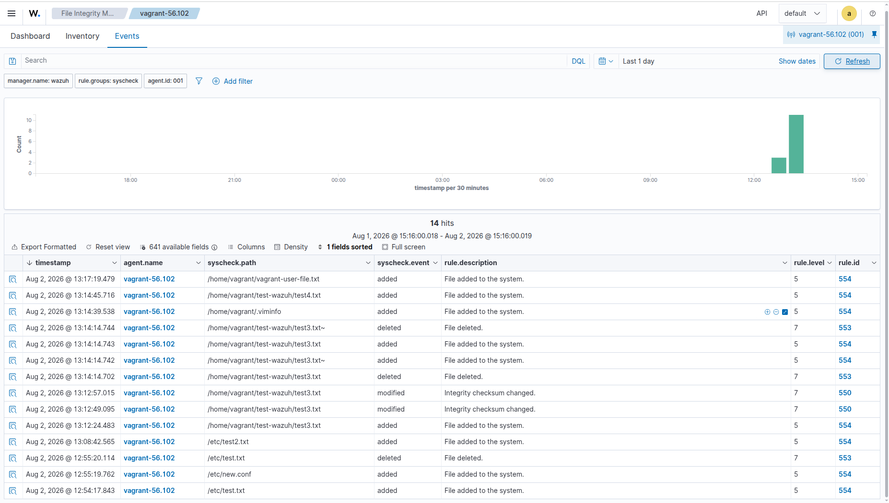
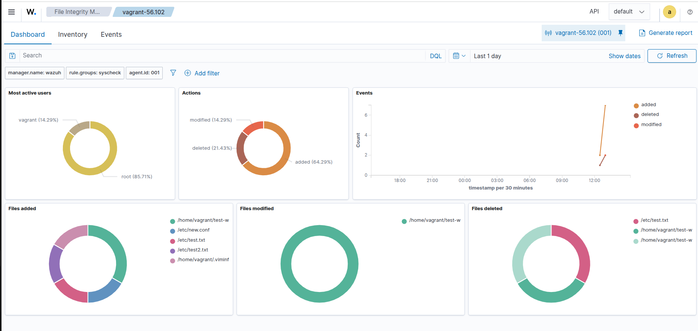

# Wazuh SIEM Handbook

Practical documentation for deploying and operating **Wazuh SIEM** — covering server setup, agent integration, file integrity monitoring (FIM), and ongoing security operations guides.

This handbook is built from real lab deployments and is continuously updated as new configurations, detections, and integrations are added.

---

## 📌 Overview

| | |
|---|---|
| **SIEM** | Wazuh |
| **Version** | 4.14 |
| **Deployment type** | All-in-one (Manager + Indexer + Dashboard) |
| **OS** | Ubuntu (Server & Agents) |
| **Status** | 🟢 Actively maintained |

This repo documents a hands-on Wazuh lab setup — useful for DevOps/DevSecOps engineers looking to add security monitoring alongside application monitoring, or anyone learning SIEM operations from scratch.

---

## 📂 Repository Structure

```
wazuh-siem-handbook/
├── README.md                          # you are here
├── docs/
│   ├── 01-server-setup.md             # manager installation & full logging
│   ├── 02-agent-installation.md       # agent enrollment
│   ├── 03-fim-configuration.md        # file integrity monitoring setup
│   ├── 04-active-response.md          # (planned)
│   ├── 05-custom-rules.md             # (planned)
│   └── troubleshooting.md             # (planned)
├── images/
│   ├── sshd.png
│   ├── file-integrity-monitoring.png
│   └── file_system_events_monitoring.png
├── configs/
│   ├── ossec.conf.manager.sample
│   └── ossec.conf.agent.sample
└── LICENSE
```

---

## 📖 Documentation Index

| Guide | Description |
|---|---|
| [Server Setup](./docs/01-server-setup.md) | Installing the Wazuh manager, indexer, and dashboard; enabling full event logging (`logall`) |
| [Agent Installation](./docs/02-agent-installation.md) | Installing and enrolling agents against the manager |
| [FIM Configuration](./docs/03-fim-configuration.md) | Enabling real-time File Integrity Monitoring (`syscheck`) on critical directories |
| Active Response *(coming soon)* | Automated response actions to detected threats |
| Custom Rules *(coming soon)* | Writing and tuning custom detection rules |
| Troubleshooting *(coming soon)* | Common issues and fixes |

---

## 🖼️ Preview

**Agent registration confirmed in the dashboard:**



**File Integrity Monitoring — overview:**



**File Integrity Monitoring — event details:**



---

## 🚀 Quick Start

```bash
# 1. Clone the repo
git clone https://github.com/<your-username>/wazuh-siem-handbook.git
cd wazuh-siem-handbook

# 2. Follow the guides in order
docs/01-server-setup.md
docs/02-agent-installation.md
docs/03-fim-configuration.md
```

---

## 🛠️ Tech Stack

- **Wazuh Manager / Indexer / Dashboard** — v4.14
- **Wazuh Agent** — v4.14.7
- **OS** — Ubuntu (Server & Agent)
- **Networking** — Static IP lab environment (VirtualBox / Vagrant)

---

## ⚠️ Security Note

This repo is meant for **learning and lab documentation purposes**. Before publishing any configuration:

- Never commit real IP addresses, credentials, or API keys — use placeholders (`<manager-ip>`, `<password>`).
- Rotate any default/auto-generated passwords immediately after setup.
- Review `configs/*.sample` files before applying them to production systems.

---

## 🤝 Contributing

This is primarily a personal lab journal, but suggestions, corrections, and additional guides are welcome:

1. Fork the repo
2. Create a feature branch (`git checkout -b docs/active-response`)
3. Commit your changes
4. Open a pull request

---

## 📅 Changelog

| Date | Update |
|---|---|
| 2026-08-02 | Initial handbook: server setup, agent installation, FIM configuration |

---

## 📄 License

This project is licensed under the [MIT License](./LICENSE) — feel free to use and adapt it for your own lab documentation.

---

## 🔖 Tags

`wazuh` `siem` `soc` `blue-team` `devsecops` `cybersecurity` `homelab` `security-monitoring` `fim`
