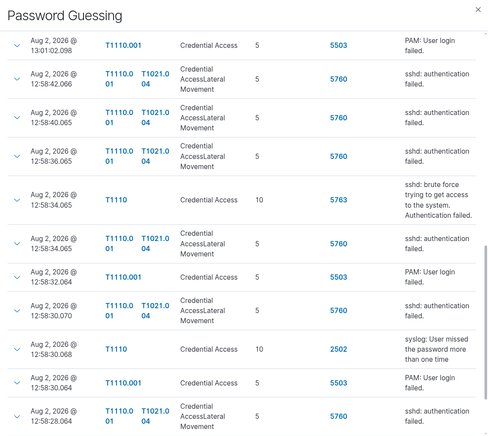
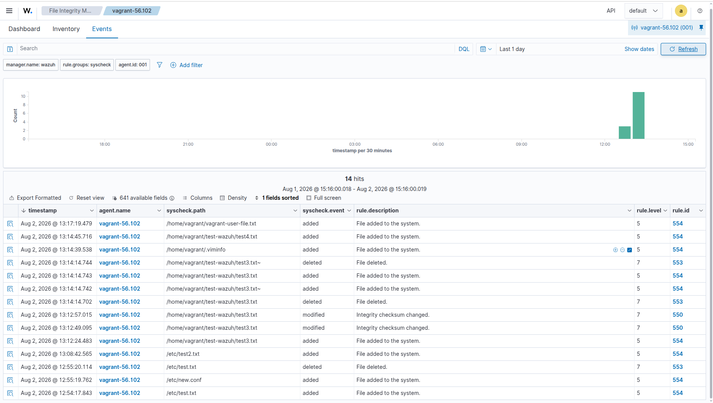
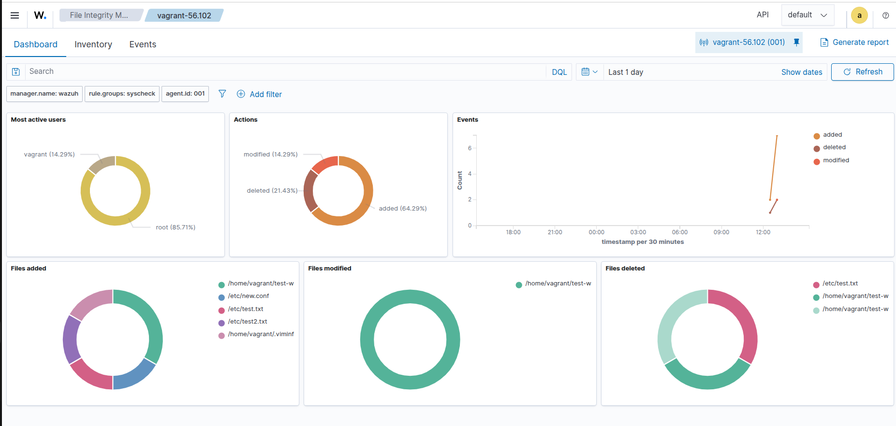

# Wazuh SIEM Deployment Documentation

## Overview

This document describes the end-to-end setup of a Wazuh deployment consisting of:

- **Wazuh Server (Manager)** — installed via the all-in-one installer, with full logging (`logall`) enabled for archiving all events.
- **Wazuh Agent(s)** — installed on endpoints and registered against the manager, with File Integrity Monitoring (FIM / `syscheck`) enabled in real-time mode.

| Component | Version | Role |
|---|---|---|
| Wazuh Manager | 4.14 | Central server (indexer, manager, dashboard) |
| Wazuh Agent | 4.14.7-1 | Endpoint monitoring agent |
| Manager IP | `192.168.56.102` | Reachable by all agents |

---

## 1. Wazuh Server Installation

### 1.1 Prerequisites

Update the OS and switch to root before proceeding.

```bash
sudo apt update && sudo apt upgrade -y
sudo su
mkdir -p /root/wazuh
cd /root/wazuh
```

### 1.2 Run the All-in-One Installer

The `wazuh-install.sh` script (`-a` flag) installs and configures the Wazuh indexer, manager, and dashboard together on a single node.

```bash
curl -sO https://packages.wazuh.com/4.14/wazuh-install.sh
sudo bash ./wazuh-install.sh -a
```

### 1.3 Access the Dashboard

At the end of the installation, the script prints the dashboard URL and the auto-generated `admin` password. Save these credentials securely (e.g., in a password manager) and rotate the password after first login.

```
URL:      https://192.168.56.102/
User:     admin
Password: <generated password — save and rotate after first login>
```

> ⚠️ **Security note:** Treat the installer-generated password as a one-time bootstrap credential. Change it immediately after your first successful login, and avoid storing it in shared documentation or version control.

### 1.4 Enable Full Event Logging (Archives)

By default, Wazuh only logs alerts that match a rule. To retain **all** incoming events (not just alerts) for auditing, threat hunting, or compliance, enable the `logall` and `logall_json` options in `ossec.conf`.

```bash
sudo sed -i \
  -e 's|<logall>no</logall>|<logall>yes</logall>|g' \
  -e 's|<logall_json>no</logall_json>|<logall_json>yes</logall_json>|g' \
  /var/ossec/etc/ossec.conf

sudo systemctl restart wazuh-manager
```

### 1.5 Verify the Configuration

```bash
grep -E '<logall>|<logall_json>' /var/ossec/etc/ossec.conf
sudo systemctl status wazuh-manager --no-pager
```

Expected output should show:
```xml
<logall>yes</logall>
<logall_json>yes</logall_json>
```

And `wazuh-manager` should report as **active (running)**.

> 📁 With `logall_json` enabled, all events are written to `/var/ossec/logs/archives/archives.json`, which can be ingested by the Wazuh indexer for full-event visibility in the dashboard (not just alerts).

---

## 2. Wazuh Agent Installation

Perform these steps on **each endpoint** you want to monitor.

### 2.1 Prerequisites

```bash
sudo apt update && sudo apt upgrade -y
sudo su
mkdir -p /root/wazuh-agent
cd /root/wazuh-agent
```

### 2.2 Download and Install the Agent Package

The `WAZUH_MANAGER`, `WAZUH_AGENT_GROUP`, and `WAZUH_AGENT_NAME` environment variables pre-configure the agent to register with the manager and join a group automatically during installation.

```bash
wget https://packages.wazuh.com/4.x/apt/pool/main/w/wazuh-agent/wazuh-agent_4.14.7-1_amd64.deb

sudo WAZUH_MANAGER='192.168.56.102' \
     WAZUH_AGENT_GROUP='default' \
     WAZUH_AGENT_NAME='vagrant-56.102' \
     dpkg -i ./wazuh-agent_4.14.7-1_amd64.deb
```

| Variable | Value | Purpose |
|---|---|---|
| `WAZUH_MANAGER` | `192.168.56.102` | IP of the manager the agent reports to |
| `WAZUH_AGENT_GROUP` | `default` | Agent group for shared configuration |
| `WAZUH_AGENT_NAME` | `vagrant-56.102` | Unique agent name shown in the dashboard |

### 2.3 Enable and Start the Agent Service

```bash
sudo systemctl daemon-reload
sudo systemctl enable wazuh-agent
sudo systemctl start wazuh-agent
```

### 2.4 Verify Agent Registration in the Dashboard

Once the agent service is running, confirm it has registered successfully and is reporting to the manager by checking the **Endpoints Summary** page in the Wazuh dashboard:

```
https://192.168.56.102/app/endpoints-summary#/agents?tab=welcome&agent=001
```


*Agent `001` welcome/summary view — confirms the agent is enrolled, active, and reporting data to the manager.*

---

## 3. File Integrity Monitoring (FIM) Configuration

### 3.1 Edit the Agent Configuration

Open the agent's local configuration file:

```bash
vim /var/ossec/etc/ossec.conf
```

Update (or add) the `<syscheck>` block to enable real-time FIM on key directories:

```xml
<syscheck>
  <disabled>no</disabled>
  <frequency>60</frequency>
  <scan_on_start>yes</scan_on_start>

  <directories check_all="yes" realtime="yes" report_changes="yes">
      /etc,/home,/opt
  </directories>
</syscheck>
```

| Setting | Value | Description |
|---|---|---|
| `disabled` | `no` | Ensures FIM is active |
| `frequency` | `60` | Runs a full scheduled scan every 60 seconds (in addition to real-time monitoring) |
| `scan_on_start` | `yes` | Performs a baseline scan when the agent starts |
| `realtime` | `yes` | Uses inotify (Linux) to detect file changes instantly |
| `report_changes` | `yes` | Logs a diff of what changed in monitored files |
| Monitored paths | `/etc, /home, /opt` | Directories under FIM coverage |

### 3.2 Restart the Agent and Verify

```bash
sudo systemctl restart wazuh-agent
sudo systemctl status wazuh-agent
```

Confirm the service is **active (running)** with no errors in the status output.

### 3.3 FIM Dashboard Views

Once FIM is active, the Wazuh dashboard provides both a high-level overview and a detailed event log of file system changes.

**Overview — created / modified / deleted event counts:**


*Graphical summary showing the total count of file create, modify, and delete events detected by syscheck.*

**Detailed event log:**


*Itemized list of individual file system events (created, modified, deleted) captured under the monitored directories (`/etc`, `/home`, `/opt`).*

---

## 4. Post-Setup Verification Checklist

- [ ] Wazuh dashboard is reachable at `https://<manager-ip>/`
- [ ] Logged in with `admin` and rotated the default password
- [ ] `logall` / `logall_json` confirmed as `yes` in manager's `ossec.conf`
- [ ] `wazuh-manager` service is active
- [ ] Agent appears as **Active** under **Agents** in the dashboard
- [ ] `wazuh-agent` service is active on each endpoint
- [ ] FIM (`syscheck`) is enabled and reporting changes for `/etc`, `/home`, `/opt`
- [ ] Test FIM by modifying a file (e.g., `touch /etc/testfile`) and confirming an alert appears in the dashboard under **Integrity Monitoring**

---

## 5. Useful Commands Reference

| Purpose | Command |
|---|---|
| Restart manager | `sudo systemctl restart wazuh-manager` |
| Restart agent | `sudo systemctl restart wazuh-agent` |
| Check manager status | `sudo systemctl status wazuh-manager --no-pager` |
| Check agent status | `sudo systemctl status wazuh-agent --no-pager` |
| View manager logs | `tail -f /var/ossec/logs/ossec.log` |
| View archived events | `tail -f /var/ossec/logs/archives/archives.json` |
| List agent config | `cat /var/ossec/etc/ossec.conf` |

---

## Notes

- This setup uses a **single-node all-in-one** Wazuh install (manager + indexer + dashboard together). For production environments, consider separating these components across multiple nodes for scalability and resilience.
- Agent registration here uses **pre-set environment variables** during package installation; alternatively, agents can be registered manually using `agent-auth` or via the dashboard's enrollment wizard.
- Always validate firewall rules allow agent-to-manager communication on the default Wazuh ports (**1514/TCP** for events, **1515/TCP** for agent enrollment, **55000/TCP** for the API).
